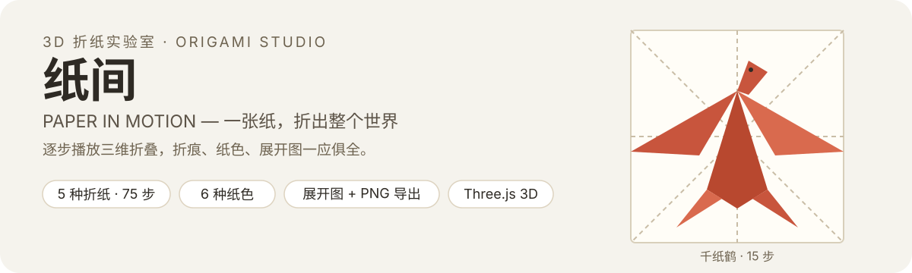
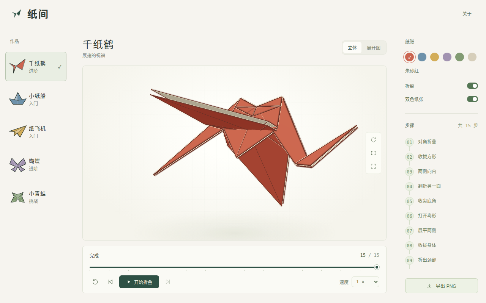

<p align="right"><a href="README.md">中文</a></p>

<p align="center">
  
</p>

<p align="center">
  <a href="https://xiaosang.cc/origami-studio/">▶ Live Demo</a>
  ·
  <a href="https://github.com/holynova/origami-studio">GitHub Repository</a>
</p>

Paper in Motion is a 3D origami studio in the browser: watch a flat sheet fold into a finished model, step by step, in three dimensions. Five classic models, 75 steps in total — play, scrub, switch paper colors, inspect the full crease pattern, and export PNGs. Plain HTML / CSS / JavaScript + Three.js, no build step.

## Screenshots

<p align="center">
  
</p>

## Five Models

| Model | Difficulty | Steps | In one line |
|------|------|------|--------|
| 千纸鹤 (Paper Crane) | Intermediate | 15 | A blessing, wings spread |
| 小纸船 (Little Boat) | Beginner | 7 | Carrying a small dream |
| 纸飞机 (Paper Plane) | Beginner | 9 | The next stop is far away |
| 蝴蝶 (Butterfly) | Intermediate | 18 | A moment of lightness, paused |
| 小青蛙 (Little Frog) | Challenge | 26 | A tiny creature on paper |

## Features

- **Step-by-step 3D folding**: play / pause, previous / next step, restart; scrubbable timeline; 0.5× / 1× / 1.5× / 2× speeds.
- **Rotate & zoom**: drag to rotate, scroll or pinch to zoom; auto-rotate, reset view, fullscreen.
- **Six paper colors**: 朱砂红 (cinnabar red), 雾海蓝 (mist-sea blue), 麦芽黄 (malt yellow), 藤萝紫 (wisteria purple), 青竹绿 (bamboo green), 原纸白 (plain white); two-tone paper supported.
- **Crease highlighting**: screen-pixel-wide strokes with dark indent + narrow highlight; current fold line highlighted. Full crease-pattern view included.
- **Export PNG** of the current 3D view or the crease pattern.
- **Keyboard**: Space to play/pause, ←/→ to step. Responsive on desktop and mobile.

## Limits

- Folding uses shared-mesh length constraints with small numerical error (max ~0.583 mm at step endpoints on a 150 mm sheet); paper thickness and full self-collision are not simulated, so complex closing steps may intersect.
- Step titles are navigation aids, not a professionally proofread folding tutorial.

## Run Locally

No build step — serve `dist/` with any static server (ES modules and model JSON must load over HTTP; double-clicking `file://` won't work). WebGL required.

```bash
npm run dev      # python3 -m http.server 5186 --directory dist
```

Check models and syntax:

```bash
npm run check    # node --check + scripts/check-models.mjs
```

## Tech

- Plain HTML / CSS / JavaScript + Three.js r170 (vendored locally, no CDN; optional Google Fonts fall back to system Chinese fonts if they fail to load).
- Folding animation derives rigid transforms per face, interpolating rotation about crease axes, with edge-length and face-diagonal constraints on shared vertices so faces never separate.
- Model data is precomputed by a Java exporter from `.ori` source models (`scripts/java/`; no Java needed to run in the browser).

```
dist/index.html     Chinese workbench with responsive layout
dist/app.js         Three.js scene, input, playback, settings, PNG export
dist/fold.js        Per-face rigid transforms, rotation interpolation about crease axes
dist/creases.js     Crease strokes, shadow highlights, current crease detection
dist/models/*.json  Precomputed sheet coordinates, face connectivity, per-step start/end coordinates
scripts/java/       Reproducible Java exporter and geometry source for model data
scripts/models/     .ori source models
```

## Credits

The origami geometry engine and traditional origami models come from [Origami Editor 3D](https://github.com/bagyoni/origamieditor3d) by Attila Bágyoni (GPL-3.0). The workbench, rigid animation player, Three.js rendering, and export adapter are original to this project. Three.js r170 is MIT.

## License

GPL-3.0-only, see `LICENSE`.
