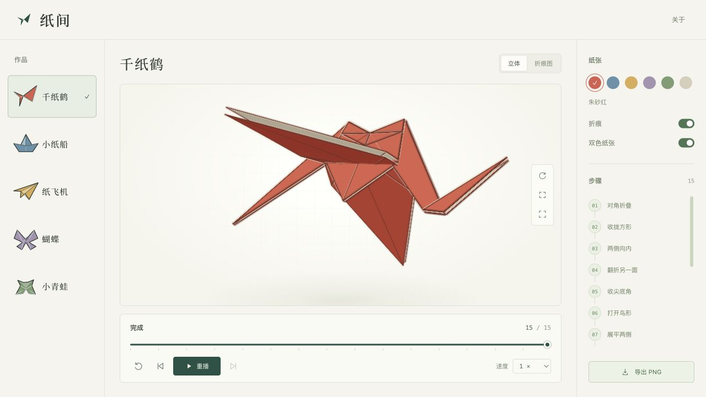

# 纸间 · Paper in Motion

中文：浏览器里的三维折纸实验室，包含千纸鹤、小船、纸飞机、蝴蝶和青蛙。支持逐步播放、旋转缩放、折痕高亮、六种纸色、展开图与 PNG 导出。使用原生 HTML、CSS、JavaScript 和 Three.js，无需构建。折叠采用共享网格长度约束，存在小幅数值误差，未实现完整自碰撞。

English: An interactive 3D origami studio featuring a crane, boat, airplane, butterfly, and frog. Play or scrub through each fold, rotate and zoom the paper, inspect highlighted creases, switch paper colors, view crease patterns, and export PNG images. Built with plain HTML, CSS, JavaScript, and Three.js. The shared-mesh folding visualization uses length constraints with small numerical tolerances; full self-collision is not implemented.



## 在线体验 / Live Demo

- [Cloudflare Demo — 待验证 / pending verification](https://origami-studio.xiaosang.cc/)
- [GitHub Repo](https://github.com/holynova/origami-studio)


## 本地运行 / Run locally

```sh
npm ci
npm run dev
```

Open http://localhost:5186/ . WebGL is required.

## 检查与发布 / Check and deploy

```sh
npm run check
npm run deploy:check
npm run deploy
```

Cloudflare Workers · `origami-studio.xiaosang.cc` · `main`.

源码与部署配置保存在同一主分支，在本地手动发布。 / Source and deployment configuration share one main branch; deployments run manually from that commit.

## 来源 / Credits

[Origami Editor 3D](https://github.com/bagyoni/origamieditor3d), Attila Bágyoni: geometry and traditional models, GPL-3.0. Three.js r170: MIT. The studio interface, crease renderer, and playback adapter are original additions. See [LICENSE](./LICENSE), [development notes](./docs/DEVELOPMENT.md), and [release record](./docs/RELEASE.md).
