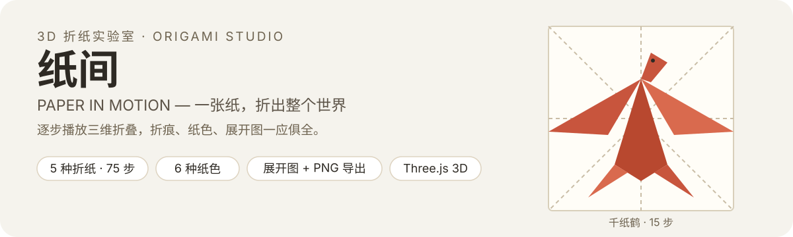
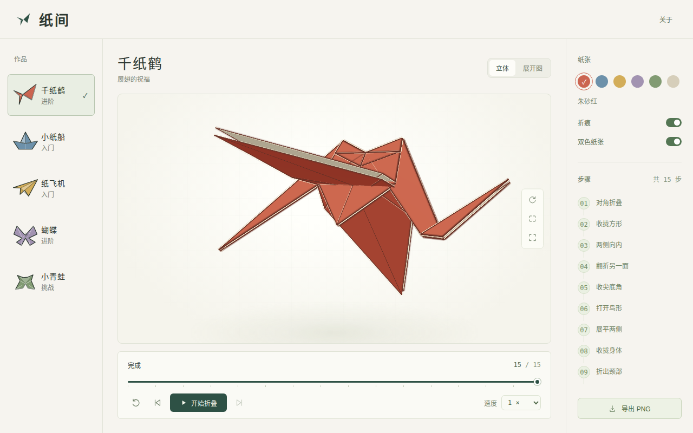

<p align="right"><a href="README.en.md">English</a></p>

<p align="center">
  
</p>

<p align="center">
  <a href="https://xiaosang.cc/origami-studio/">▶ 在线体验</a>
  ·
  <a href="https://github.com/holynova/origami-studio">GitHub 仓库</a>
</p>

纸间是浏览器里的三维折纸实验室：一张纸从平铺到成品，每一步都在 3D 里慢慢折给你看。五种经典折纸共 75 步，可播放、可拖进度、可换纸色，还能看完整展开图、导出 PNG。原生 HTML / CSS / JavaScript + Three.js，无需构建，打开即用。

## 截图

<p align="center">
  
</p>

## 五种折纸

| 作品 | 难度 | 步数 | 一句话 |
|------|------|------|--------|
| 千纸鹤 | 进阶 | 15 步 | 展翅的祝福 |
| 小纸船 | 入门 | 7 步 | 载着小小的梦 |
| 纸飞机 | 入门 | 9 步 | 下一站是远方 |
| 蝴蝶 | 进阶 | 18 步 | 停留片刻的轻盈 |
| 小青蛙 | 挑战 | 26 步 | 纸上的小小生灵 |

## 功能

- **逐步 3D 折叠**：播放 / 暂停、上一步 / 下一步、从头开始；进度可拖动，0.5 / 1 / 1.5 / 2 倍速。
- **旋转缩放**：鼠标拖动或单指滑动旋转，滚轮或双指捏合缩放；自动旋转、重置视角、全屏。
- **六种纸色**：朱砂红、雾海蓝、麦芽黄、藤萝紫、青竹绿、原纸白；支持双色纸张。
- **折痕高亮**：屏幕像素宽描线，深色压痕 + 窄亮边，当前折线高亮；另有完整展开图（折痕图）视图。
- **导出 PNG**：导出当前三维视角或折痕图。
- **键盘操作**：空格播放 / 暂停，左右方向键切换步骤；桌面与移动端响应布局。

## 边界

- 折叠采用共享网格长度约束，存在小幅数值误差（按纸宽 150 mm 计，步骤端点最大约 0.583 mm）；未实现纸张厚度与完整自碰撞，复杂收拢步骤可能出现面片相交。
- 步骤标题用于导航，不替代经过专业校对的手工折纸教程。

## 本地运行

无需构建，用任意静态服务托管 `dist/` 即可（ES modules 与模型 JSON 需经 HTTP 加载，不支持直接双击 `file://`）；需要 WebGL。

```bash
npm run dev      # python3 -m http.server 5186 --directory dist
```

检查模型与语法：

```bash
npm run check    # node --check + scripts/check-models.mjs
```

## 技术

- 原生 HTML / CSS / JavaScript + Three.js r170（本地 vendor，无需 CDN；可选 Google Fonts 失败时回退系统中文字体）。
- 折叠动画按面片推导刚性变换、绕折线轴旋转插值，并对共享顶点施加边长及面对角线约束，避免面片分离。
- 模型数据由 Java 导出器从 `.ori` 原始模型预计算生成（`scripts/java/`，浏览器运行不需要 Java）。

```
dist/index.html     中文工作台与响应式布局
dist/app.js         Three.js 场景、输入、播放、设置、PNG 导出
dist/fold.js        按面片推导刚性变换，绕折线轴旋转插值
dist/creases.js     折痕描线、阴影亮边、当前折线识别
dist/models/*.json  预计算纸面坐标、面片连接、每步起止坐标
scripts/java/       可复现模型数据的 Java 导出器与几何源码
scripts/models/     .ori 原始模型
```

## 来源

折纸几何引擎与传统折纸示例来自 [Origami Editor 3D](https://github.com/bagyoni/origamieditor3d)（Attila Bágyoni，GPL-3.0）。工作台、刚性动画播放器、Three.js 渲染与导出适配器为本项目原创。Three.js r170 为 MIT 许可。

## 许可

GPL-3.0-only，见 `LICENSE`。
